<div align="center">

# 💳 SpendTrack

### Full Stack Web Application · Personal Financial Tracking & Budget Management
**Department of Computer Applications** · Full Stack Development

`Software` · `Financial Analytics` · `MERN Stack`

<br>

**Real-time tracking. Deterministic budgeting.**
Every rupee accounted for — automated categorization, instant analytics, strict user isolation.

</div>

---

## The problem

Personal finances leak through **hundreds of micro-transactions each month** — quick digital payments, canteen meals, transit recharges, course subscriptions, unmonitored utility bills. Payment apps faithfully record transactions as isolated line items.

Recording is not the same as *managing*. Bank statements scroll endlessly, so the hard questions go unasked:

<table>
<tr><td width="34%"><b>💸 Where did the balance go?</b></td><td>Small ₹150–₹500 payments go unnoticed individually. At month-end, the account is empty without a single large purchase to account for it.</td></tr>
<tr><td><b>📊 Which category is bleeding money?</b></td><td>Food, travel, online shopping, and subscriptions compete for budget. Without automated category aggregation, you cannot see which habit drove the deficit.</td></tr>
<tr><td><b>🔍 Can you find a payment from two weeks ago?</b></td><td>Searching through raw passbooks or SMS logs requires manual date-by-date scrolling. A searchable, filterable ledger is invisible unless indexed by title and category.</td></tr>
<tr><td><b>🔒 Is user data isolated?</b></td><td>Most student projects share a single database collection without query scoping — any authenticated user can read or tamper with another user's financial ledger.</td></tr>
<tr><td><b>⚡ Are metrics computed live?</b></td><td>Static spreadsheets require manual formulas. When a transaction is added, edited, or deleted, total spend, transaction volume, and highest category should recalculate instantaneously.</td></tr>
<tr><td><b>🔁 What about edits and cancellations?</b></td><td>Entered an incorrect amount or received a refund? A static log requires manual re-entry instead of seamless in-place updates with confirmation guards.</td></tr>
</table>

**And the one no spreadsheet can catch:** a multi-device session that looks authenticated but sends forged tokens or accesses endpoints without ownership validation. Nothing fires on the client. Everything looks valid in the UI — which is what broken authorization and cross-tenant data leaks actually look like.

---

## The solution

Three layers of software engineering, **in order of execution** — and an intuitive user interface at the front of all of them.

| Layer | What it does | Needs |
|---|---|---|
| **React 18 + Redux Toolkit** | Pure functional UI components driven by a centralized immutable state store. Dispatches async thunks, manages loading spinners, error alerts, and live category aggregations | Browser |
| **Express REST API & Middleware** | Stateless RESTful controller routes with centralized error handling, `express-validator` schema rules, and cryptographic JWT `protect` middleware | Node.js |
| **Mongoose ODM & MongoDB Atlas** | Strictly typed schemas (`User`, `Expense`) with enum validations, index constraints, relational ObjectId references, and multi-tenant user scoping | MongoDB Atlas |
| **Axios Interceptor Pipeline** | Client-side HTTP gateway that automatically extracts the session token, injects the `Authorization: Bearer` header, and handles 401 token expiry redirects | Browser |

> **Strict multi-user isolation by design.** Every database query is bounded to `user: req.user._id`. A request without a valid signed JWT is rejected with HTTP `401 Unauthorized`; an attempt to read, edit, or delete another user's record is blocked with HTTP `403 Forbidden`. **Data isolation is enforced at the database query level, never by hiding buttons.**

---

## Why we are different

<table>
<tr>
<td width="50%" valign="top">

### 🧾 Every transaction is an auditable record

Not a loose list. Every expense carries six distinct attributes:

1. **The title**, descriptive and trimmed
2. **The exact amount**, formatted cleanly in INR (₹)
3. **The category**, strictly bound to validated enums (`Food`, `Travel`, `Shopping`, `Bills`, `Education`, `Other`)
4. **The date**, indexed for chronological sorting
5. **Notes**, optional contextual remarks
6. **The owner reference**, bound to the authenticated user ID

A user can search, filter, update, or remove any transaction with instant feedback.

</td>
<td width="50%" valign="top">

### 🔒 Security is a query filter, not a hidden button

`req.user._id` is extracted directly from the verified cryptographic JWT signature and attached to the query:

```javascript
Expense.find({ user: req.user._id, ...filters })
```

Forging an ID in the URL parameter yields `403 Forbidden` or `404 Not Found`. The failure mode is *deny by default*, never *leak data*.

Proved by an automated cross-user isolation test in `server/test_api.js`. User B attempting to access User A's expense is refused. **That test runs on every build.**

</td>
</tr>
<tr>
<td valign="top">

### 🧭 Built on pure fundamentals, zero bloat

No heavy UI libraries, component frameworks, or CSS bloat. Built with **clean, modern plain CSS** utilizing CSS custom properties, responsive flexbox, and CSS grid.

- Crisp typography using **Plus Jakarta Sans**
- Category badges styled with distinct semantic color tokens
- Interactive metric cards that calculate totals on the fly via `useMemo`
- 100% responsive across mobile viewports, tablets, and wide monitors

</td>
<td valign="top">

### ⚖️ Cryptographically secured stateless sessions

No server-side memory sessions or database polling for authentication.

- Passwords salted with **10 rounds of bcrypt** (`bcryptjs`) before database storage
- Stateless **JSON Web Tokens (JWT)** signed with a 256-bit server secret
- Automatic token expiration (7 days)
- Password hashes excluded from all JSON query projections (`-password`)
- 1-click **Demo Auto-fill** button for instant evaluation without manual typing

</td>
</tr>
</table>

---

## Architecture

```mermaid
flowchart LR
    subgraph CLIENT["Client Layer (React 18 + Vite)"]
        direction TB
        UI["Functional Components<br/>(Navbar, Dashboard, Forms)"]
        RTK["Redux Toolkit Store<br/>(authSlice + expenseSlice)"]
        AX["Axios Interceptor<br/>Bearer Token Injection"]
        UI --> RTK
        RTK --> AX
    end

    subgraph SERVER["Backend Layer (Node.js + Express)"]
        direction TB
        MW["Auth Middleware<br/>jwt.verify()"]
        VAL["express-validator<br/>Schema Rules"]
        CTRL["Controller Layer<br/>(authController, expenseController)"]
        MW --> VAL
        VAL --> CTRL
    end

    subgraph DATA["Data Layer (MongoDB Atlas)"]
        direction TB
        MOD["Mongoose Models<br/>(User, Expense)"]
        DB[("MongoDB Atlas<br/>Cloud Database")]
        MOD --> DB
    end

    AX -->|"HTTP Requests (JSON)"| MW
    CTRL --> MOD
    DB -.->|"Documents"| CTRL
    CTRL -.->|"HTTP Response (200 / 201)"| AX
    AX -.->|"Immutable State Update"| RTK
    RTK -.->|"Re-render"| UI

    style CLIENT fill:#f8fafc,stroke:#4f46e5,stroke-width:2px
    style SERVER fill:#f8fafc,stroke:#0284c7,stroke-width:2px
    style DATA fill:#f8fafc,stroke:#10b981,stroke-width:2px
```



State changes flow in a **single strict unidirectional loop**: User interaction triggers a Redux `createAsyncThunk` $\rightarrow$ Axios injects JWT Bearer token $\rightarrow$ Express middleware authenticates signature $\rightarrow$ Controller executes scoped Mongoose query $\rightarrow$ MongoDB returns document $\rightarrow$ Redux extraReducers update store $\rightarrow$ React re-renders subscribed components.

---

## One system, complete user isolation

All users communicate with the **same** REST API endpoints. The JWT context determines database visibility — there is no shared or unpartitioned data leak.

| Endpoint / Operation | HTTP Method | Access Level | Data Boundary Enforced |
|---|:---:|:---:|---|
| `/api/auth/register` | `POST` | Public | Validates unique email, hashes password with bcrypt |
| `/api/auth/login` | `POST` | Public | Compares bcrypt hash, issues 7-day signed JWT |
| `/api/auth/me` | `GET` | **Private** | Returns current user profile without password hash |
| `/api/expenses` | `GET` | **Private** | Returns records strictly scoped to `{ user: req.user._id }` |
| `/api/expenses` | `POST` | **Private** | Creates new record with `user = req.user._id` |
| `/api/expenses/:id` | `GET` | **Private** | Returns record only if `expense.user == req.user._id` |
| `/api/expenses/:id` | `PUT` | **Private** | Updates record only if ownership check passes |
| `/api/expenses/:id` | `DELETE`| **Private** | Deletes record only if ownership check passes |

An unauthenticated visitor navigating to `/` is intercepted by `<ProtectedRoute>` and redirected to `/login`. Attempting to query `/api/expenses` directly via HTTP clients returns `401 Unauthorized`.

---

## Results & Verification

<div align="center">

| Suite | Tests | Covers | Status |
|---|:---:|---|:---:|
| `server/test_api.js` | **15** | Health check · 401 unauth · 401 invalid token · Registration · Duplicate prevention · Login · Auth Me · Expense listing · Category filter · Title regex search · CRUD operations · Cross-user 403 isolation · 404 verification | **15 / 15 Passed** |
| `client (Vite Build)` | **113 modules** | React 18 · Redux Toolkit · React Router v6 · Axios interceptors · Responsive CSS design system | **Zero errors (519ms)** |
| `database:seed` | **8 records** | Demo user generation + 8 diverse transactions across all valid categories | **Verified** |

**8 transactions seeded · 6 valid categories · 15 automated integration tests · 100% test pass rate**

</div>

> **What that 100% is worth.** The automated test suite (`node server/test_api.js`) issues live HTTP requests against the running Express server and MongoDB database. It tests successful flows, boundary edge cases, duplicate constraint rejections, and malicious cross-tenant tampering.

---

## Data provenance — read this first

> ### ⚠️ The dataset in this repository is **seeded for demonstration**.
> It is generated locally by `server/seed.js` to provide an instant, realistic sandbox for testing and evaluation.

| | |
|---|---|
| **Real** | Modern full-stack architecture, production-ready JWT authentication, responsive layout, real MongoDB Atlas cloud database |
| **Fictional** | The demo user (`demo@spendtrack.com`) and all seeded financial transactions |
| **Isolated** | Every newly registered user starts with a completely clean, empty ledger isolated from other accounts |

When evaluating, you can use the built-in demo credentials with 1 click, or register a new user to test a completely clean slate.

---

## Run it

Requires **Node.js (v18+)** and a **MongoDB** connection (local or MongoDB Atlas).

```bash
# 1. Clone repository
git clone https://github.com/5athv1k/Spendtrack.git
cd Spendtrack

# 2. Setup Server
cd server
npm install
npm run seed       # Seeds the database with demo user & 8 sample expenses
npm run dev        # Starts Express server on port 5001

# 3. Setup Client (in a second terminal)
cd ../client
npm install
npm run dev        # Starts Vite React client on http://localhost:5173
```

Open your browser and navigate to:  
👉 **`http://localhost:5173`**

<details>
<summary><b>Demonstration account</b> — password <code>Demo@123</code></summary>

| Email | Password | Role | Access |
|---|---|---|---|
| `demo@spendtrack.com` | `Demo@123` | Demo Student | Pre-seeded with 8 transactions across Food, Travel, Shopping, Bills, Education, Other |

*(A 1-click **"Auto-fill Demo"** button is built into the Login screen for instant access).*

</details>

<details>
<summary><b>All commands</b></summary>

| Command | Location | What it does |
|---|---|---|
| `npm run dev` | `server/` | Starts backend with nodemon hot-reload |
| `npm start` | `server/` | Starts backend server in production mode |
| `npm run seed` | `server/` | Cleans and seeds demo user & 8 sample expenses |
| `node test_api.js` | `server/` | Executes automated 15-test endpoint test suite |
| `npm run dev` | `client/` | Starts Vite React frontend on port 5173 |
| `npm run build` | `client/` | Builds optimized production bundle |
| `npm run preview` | `client/` | Locally previews production build |

</details>

---

## Stack

<div align="center">

`MongoDB Atlas` · `Express.js` · `React 18` · `Node.js` · `Redux Toolkit` · `Axios` · `Vite` · `JWT` · `bcryptjs`

</div>

- **Security & Session Management:** Signed JSON Web Tokens (`jsonwebtoken`) transmitted via HTTP `Authorization: Bearer` headers; passwords salted with 10 rounds of `bcryptjs`; no sensitive credentials committed to Git.
- **State Management:** Centralized Redux Toolkit slices (`authSlice`, `expenseSlice`) handling `createAsyncThunk` request lifecycles (`pending`, `fulfilled`, `rejected`) with deterministic store hydration from `localStorage`.
- **CSS Architecture:** Zero heavy CSS dependencies (no Bootstrap, Tailwind, or Material UI). Built with 100% semantic CSS, native focus rings, smooth transitions, and responsive grid layouts.

---

## Honest limitations

We would rather you read these from us than find them yourselves.

- The currency is set to **Indian Rupees (INR / ₹)** by default and does not currently support multi-currency conversion APIs.
- The authentication token is stored in client-side **`localStorage`** for demo persistence across page refreshes. In high-security banking tiers, `httpOnly` secure cookies are preferred to mitigate XSS exposure.
- Filtering and search are performed directly via **MongoDB database queries**; fuzzy typographical search (e.g. Levenshtein distance) is not currently implemented.
- Automatic **bank account syncing** (e.g. Plaid / Open Banking API) is out of scope for this build; all transactions are entered and managed through the authenticated application interface.
- Deleting an expense is **permanent**; there is no secondary trash or soft-delete recovery bin, though a confirmation prompt is required before deletion.

---

## Further reading

| Document | What it covers |
|---|---|
| [`server/routes/expenseRoutes.js`](server/routes/expenseRoutes.js) | Complete Express route definitions with input validation chains |
| [`server/middleware/authMiddleware.js`](server/middleware/authMiddleware.js) | Cryptographic JWT verification and request context attachment |
| [`client/src/features/expenses/expenseSlice.js`](client/src/features/expenses/expenseSlice.js) | Redux Toolkit async thunks and immutable state reducer handlers |
| [`client/src/services/api.js`](client/src/services/api.js) | Axios instance with JWT request/response interceptors |

<div align="center">
<br>

**SpendTrack** · Personal Expense Tracker
MERN Stack Architecture · Sathvik B R

</div>
